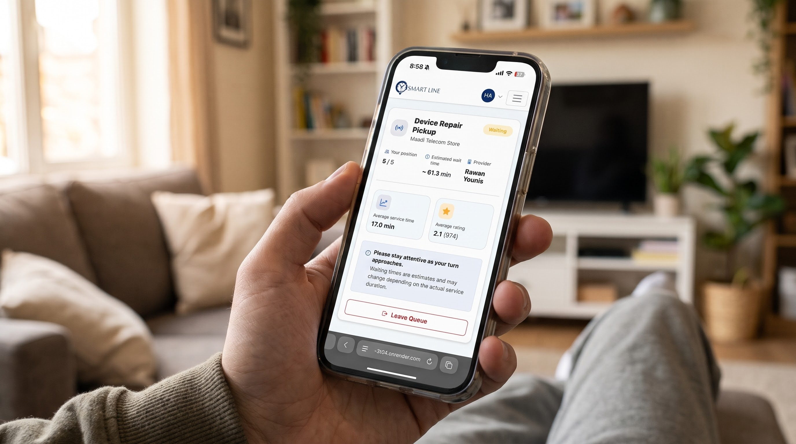

<div align="center">

# SmartLine

**Know your place in line, without standing in it.**

A queue management platform for clinics, banks and service offices.
<br>
<sub>Built as my final project for Harvard's <a href="https://cs50.harvard.edu/x">CS50x</a>.</sub>

[**Live demo**](https://smart-line-3t04.onrender.com) · [Demo accounts](#try-it-yourself)

<!-- TODO (CS50): add the video demo link here -->



</div>

## The problem

The most expensive part of any service is a walk-in queue and nobody can see it coming.

You leave home to finish one piece of paperwork. You reach the first office and find out that what you need is somewhere else. You go there, and you're sent back. Half the day is gone before you even reach the right desk.

Or you arrive at the hospital early in the morning. The doctor is running late, there are people ahead of you, and nobody can tell you how long it will take. So you wait, and your whole day disappears.

The customer loses the day. The business loses the customer's patience. And the providers work blind: they can't see how busy they are, so they can't plan.

SmartLine gives both sides a clear picture.

## What SmartLine does

Customers join a line from their phone and see where they stand, how many people are ahead, and a realistic estimate of when their turn will come.counter staff (Providers) see their live queue and call the next person. Managers see how the whole business is running, live and over time.

<div align="center">

</div>

## What each person gets

### Customer
- A clear view of their turn: how many people are ahead, when their service should start and roughly when it will end.
- No standing in a crowded room. Join from the phone, leave whenever you need to.

### Guest
Someone who doesn't want to create an account. Three things at once:
- **Fast:** joins a line in seconds.
- **Safe:** guests are limited by design, so nobody can abuse or flood a queue.
- **Future-ready:** the door is open for guests to later share an email and keep their history.

### Provider
- Sees in a second how many people are waiting, and plans the day around it.
- Knows when they'll be free: when the current customers will be done, and when there's room for other work with a clear time.
- Knows when nobody is waiting, so they can step away with confidence.
- Has their own history and performance in one place.

### Manager
- Live and historical reports and charts, split clearly.
- Control over each provider individually.
- Can drill down from one provider's history and details to today's picture, and out to the last year.

## What I Learned

I didn't start with a perfect plan. I started with the people: who waits, who serves, who runs the place. Then I built one piece at a time and let real problems reshape the design.

Building it that way exposed real bottlenecks—and changed how I will approach every project from here on:

* **More than 50% of the work happens before the first line of code.**
  Jumping into Flask too early cost me major rewrites—like tearing out my initial permanent-queue design to rebuild everything around shift-scoped queues. Starting with proper ERDs, state flows, and system diagrams saves days of refactoring later.

* **If you can't explain the architecture upfront, you aren't ready to build it.**
  Being able to clearly describe roles, data boundaries, and how components interact before opening an editor keeps every route and query consistent—and makes it easy for others to understand and collaborate on the system.

* **AI is not an architect—it needs a strict methodology.**
  AI is far less "smart" than the hype suggests; leave it to make structural decisions on its own and it generates fragile, tangled logic. It only works well when you bring the blueprint, enforce clear constraints, and give it an explicit specification to execute.

* **Edge cases belong in the database schema, not as frontend patches.**
  Problems like staff gaming their metrics, guests flooding lines, or managers closing shifts with active tickets cannot be solved with UI checks. They require state rules, audit logs, and backend guards designed from day one.

* **Local speed is a lie; production exposes every bottleneck.**
  A companies page that loaded instantly on my laptop took over a minute on Render because it computed historical wait-time averages for every company at once. Moving those calculations on-demand into active queue views fixed the delay and taught me to design for production from day one.

**Learning from documentation:** I picked up Chart.js and SQLite FTS5 by reading the docs and AI.
**Writing documentation:** this README was my first real use of Markdown: tables, collapsible sections and a diagram.


## Try it yourself

**Live demo:** https://smart-line-3t04.onrender.com

> **Heads-up:** the demo is hosted on Render, which puts it to sleep when idle. The first load can take up to **2 minutes** while it wakes up. After that it's fast.

The demo accounts below come with two years of data, so the dashboards and insights have something real to show.

| Role | Email | Password |
|---|---|---|
| Manager + Customer | mahmoud.ghoneim@yahoo.com | `Ghoneim_M2003` |
| Provider + Customer | hamdan.suleiman@gmail.com | `Hamdan#Sul90` |

You can also join a queue as a guest, with no account.

## Under the hood

Built solo in 30+ days.

| Tool | What it does here |
|---|---|
| Flask (Python) | Runs the web app and its logic | Routes, Jinja2 templates, session-based auth |
| SQLite | Stores companies, shifts, queues and history | Full-text search index kept in sync with triggers |
| SQLite FTS5 | Makes search for companies and services instant |
| JavaScript | The interactive layer: queues that update live, search and filters, forms that adapt (country, then city), and the dashboard charts | Dynamic UI, auto-refresh, client-side filtering |
| Bootstrap | Makes every page work on phones and desktops |
| Chart.js | Draws the dashboards and reports |
| Render | Hosts the live demo |

A few technical choices worth knowing about:

- **Search is safe and fast.** Parameterized queries block SQL injection, and FTS5 with automatic triggers keeps results instant.
- **Guests can't flood the system.** IP rate limiting plus a cap on active tickets per guest.
- **Login works in production, not just on my laptop.** Email verification and password recovery, with a fallback for when the hosting provider restricts outgoing email.
- **Wait estimates are calculated from real service history** per provider and service, and shared between the customer and provider pages.
- **A performance lesson.** My first version computed the full wait estimate for every company on the companies page at once. Locally it was instant; on Render it took more than a minute. A tool built to save waiting was making people wait. Now the companies page uses the lighter per-provider estimate, and the precise one is calculated only when someone opens the company they care about.
- **Time runs on UTC,** so it works for anyone, anywhere.

<details>
<summary><b>Project structure</b></summary>

```
smartLine/
├── app.py              # The Flask app: routes and the logic behind every page
├── functions.py        # Helper functions shared by the routes
├── schema.sql          # The database tables
├── seed.sql            # Demo data that fills the database
├── smallSeed.sql       # A smaller version of the demo data
├── smartline.db        # The SQLite database the demo runs on
├── accounts.txt        # Demo accounts
├── requirements.txt    # Python dependencies
├── static/             # CSS, JavaScript, logos and location lists
└── templates/          # HTML pages, grouped by role (below)
```

**`static/`**

| Files | What they are |
|---|---|
| `bootstrap.css`, `bootstrap.js` | The Bootstrap framework |
| `layout.css`, `layout.js`, `theme.css` | Shared layout, styling and colors |
| `countries.json`, `EGcities.json`, `palestineCities.json` | Country and city lists used by the forms |
| `logo.png`, `logo-white.png`, `white-logo.png`, `logo-white-background.png` | Logo variants |
| `renderFirstInFile.js`, `test.css` | Small helpers |

**`templates/`**

| Group | Pages |
|---|---|
| Shared | `layout.html` (base layout every page extends), `home.html` (landing page), `profile.html`, `apology.html` (error page) |
| Sign in | `login.html`, `register.html`, `verification.html` and `otp.html` (email verification), `forgotPassword.html` |
| Customer | `findQueue.html`, `company.html`, `QueuesOfCompany.html`, `myQueue.html`, `noJoinedQueue.html`, `customerHistory.html`, `review.html` |
| Guest | `guest.html`, `guestBan.html` |
| Provider | `providerDashboard.html`, `providerQueue.html`, `providerHistory.html`, `startQueue.html`, `unemployedMessage.html` |
| Manager | `managerGettingStarted.html`, `managerDashboard.html`, `managersQueues.html`, `managerProviders.html`, `managerReports.html` |

</details>

## What's next

- **Predictive insights:** apply machine learning to the service history to forecast wait times and busy periods, going beyond what the current estimates do.
- **Security hardening:** a proper security review and penetration testing of the platform.
- **More edge cases:** keep hunting for unusual situations, from queue abuse to odd behavior, and close them.
- **Let businesses** export their own data.

## Author

**Ziad Saleh**, Computer Science student at Helwan University, Egypt.
[GitHub](https://github.com/Ziad-CS) · [LinkedIn](https://www.linkedin.com/in/ziad-cs)
